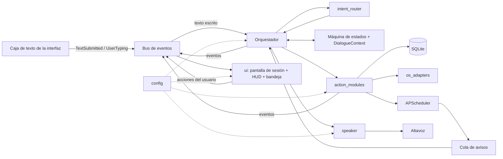
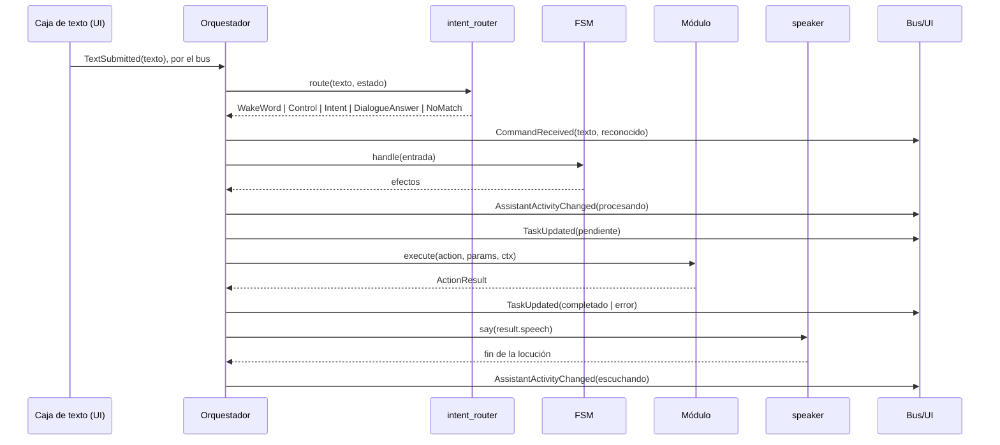

# Arquitectura

Diseño técnico del asistente. Sustituye a los antiguos `design.md` y `especificaci_n_de_arquitectura_y_refactorizaci_n.md`. Todo lo que aquí se decide es de origen `Técnico`, salvo lo que cita una restricción de origen `Idea`: puede cambiarse sin alterar el producto, actualizando este documento.

## 1. Principios

1. **Núcleo puro, bordes sucios (RES-47).** La máquina de estados, el enrutador, los analizadores y las reglas de los módulos no tocan hardware, modelos, reloj real ni sistema operativo: los reciben inyectados. Así se prueban en milisegundos.
2. **Un solo dueño del estado.** Todo el estado del asistente (FSM, sesión, diálogo, directorio de trabajo, base de datos) vive en un único hilo, el del núcleo. No hay bloqueos ni estado compartido entre hilos.
3. **Mensajes, no llamadas cruzadas.** Los hilos se comunican solo con mensajes inmutables: entradas hacia el núcleo y eventos del bus hacia la interfaz.
4. **Una sola forma de hacer cada cosa.** Una interfaz común para todas las acciones, un solo mecanismo de diálogo, un solo registro de tareas, una sola cola de avisos.
5. **Simplicidad antes que precisión extrema.** No se optimiza nada que el usuario no pueda percibir.

## 2. Componentes



| Componente | Responsabilidad | Documento |
|---|---|---|
| Entrada por texto (`ui`, `core/events`) | La caja donde el usuario escribe; entrega el texto al orquestador por el bus. | [entrada-texto.md](Modulos/Infraestructura/entrada-texto.md) |
| `intent_router` | Texto → frase de activación, frase de control, intención y entidades. | [enrutador-intenciones.md](Modulos/Infraestructura/enrutador-intenciones.md) |
| `core/state_machine` | Estado del asistente y diálogo. | [maquina-estados.md](Modulos/Infraestructura/maquina-estados.md) |
| `core/orchestrator` | Bucle de turnos: une todo lo anterior y ejecuta los efectos. | [maquina-estados.md](Modulos/Infraestructura/maquina-estados.md) |
| `action_modules` | Lógica de negocio. | [Modulos/Accion/](Modulos/Accion/) |
| `speaker` | Frases parametrizadas → voz. | [sintetizador.md](Modulos/Infraestructura/sintetizador.md) |
| `core/event_bus` | Publicación/suscripción. | [bus-eventos.md](Modulos/Infraestructura/bus-eventos.md) |
| `core/database` | SQLite y migraciones. | [persistencia.md](Modulos/Infraestructura/persistencia.md) |
| `ui` | Pantalla de sesión, HUD flotante y caja de texto. | [hud.md](Modulos/Infraestructura/hud.md), [Interfaz/README.md](Interfaz/README.md) |
| `config` | Archivos TOML. | [configuracion.md](Modulos/Infraestructura/configuracion.md) |
| `os_adapters` | Todo lo dependiente del sistema operativo. | [plataforma.md](Modulos/Infraestructura/plataforma.md) |
| `process` | Instancia única, bandeja, registro, arranque y salida. | [proceso.md](Modulos/Infraestructura/proceso.md) |

## 3. Modelo de concurrencia

| Hilo | Qué ejecuta | Regla |
|---|---|---|
| **UI** (principal) | Bucle de Qt: ventanas QML, bandeja, `UiBridge`. | Nunca hace trabajo de más de unos milisegundos. No lee la base de datos ni llama a módulos. |
| **Núcleo** | Bucle `asyncio`: orquestador, FSM, enrutador, módulos de acción, base de datos, `APScheduler`, control del `speaker`. | Dueño de todo el estado. Nada bloquea más de 50 ms: lo lento va a un ejecutor. |
| Callback de PortAudio | Salida: copia el siguiente bloque de voz. No hay flujo de entrada. | Sin Python pesado, sin registro, sin bloqueos. |
| Ejecutor **TTS** (1 hilo) | Síntesis de Piper. | — |
| `asyncio.to_thread` | Trabajo de disco potencialmente lento de los módulos (árbol, búsqueda limitada, descubrimiento de aplicaciones). | — |

Comunicación entre hilos:

- **Núcleo → UI:** los manejadores del bus se ejecutan siempre en el hilo del núcleo. `UiBridge` es un manejador que solo emite señales de Qt, que Qt entrega en el hilo de la UI (conexión en cola).
- **UI → Núcleo:** el texto que el usuario envía (`TextSubmitted`), el aviso de que está tecleando (`UserTyping`) y las demás acciones del usuario (clic en «traer al frente», «silenciar», menú de la bandeja) se publican con `bus.publish_threadsafe(evento)`, que las pasa al hilo del núcleo.
- **Nivel de audio:** el callback de salida escribe el último nivel (0–1) de la voz del asistente en una variable; un temporizador del núcleo lo publica a 20 Hz como `AudioLevel` solo mientras el asistente habla. La interfaz lo suaviza.

**Orden de las entradas.** El núcleo atiende las entradas de una en una, en el orden en que llegan. Enrutar un texto es inmediato, así que no hay resultados atrasados que descartar: lo enviado durante una frase del ciclo de vida espera a que termine y se atiende con el estado de ese momento.

## 4. Flujo de un turno



Reglas:

1. **`route` según el estado** (detalle en [enrutador-intenciones.md](Modulos/Infraestructura/enrutador-intenciones.md)): primero se prueban las frases de control; después, en `AWAITING_*`, el texto es una respuesta de diálogo; en `LISTENING_COMMAND`, se clasifica contra los patrones; en `IDLE`, solo vale la frase de cierre.
2. **`run_task`** es la única función que ejecuta acciones. Crea la tarea en `pendiente`, la registra como actividad, llama a `execute`, captura cualquier excepción (RNF-23), fija el estado final, actualiza la actividad y dice `result.speech`. Los módulos no registran actividades ni publican `TaskUpdated` de su tarea principal.
3. **Un turno a la vez (RN-44).** El orquestador ejecuta cada turno como una tarea `asyncio`. Mientras hay un turno en curso, una orden nueva espera en una cola de tamaño 1. Las frases de control no esperan: «cancelar» cancela la tarea del turno (`Task.cancel()`); «Gracias Jarvis» y «Buenas noches Jarvis» la cancelan y aplican su transición.
4. **Trabajo largo en segundo plano.** Un binario externo lanzado con una orden no ocupa el turno: `comandos.ejecutar` deja la tarea en `pendiente`, devuelve el control y, al terminar el proceso, actualiza la tarea y encola un aviso con el resultado. Dentro de un protocolo, en cambio, el binario se espera en línea.

## 5. Interfaz común de los módulos de acción

Definida en `core/action_api.py`. Es el contrato de RNF-18 y RNF-19.

```python
class SlotType(Enum):
    TEXT            # texto libre
    DIR_PATH        # carpeta existente (resolución de rutas)
    NEW_NAME        # nombre de archivo o carpeta que se va a crear
    NEW_PATH        # ruta anidada que se va a crear ("a barra b")
    INTEGER         # número, en cifras o en letras ("tres", "3", "tercero")
    DURATION        # "diez minutos", "media hora"
    DATETIME        # "mañana a las nueve"
    CATALOG         # un elemento de una lista conocida (difuso)
    COMMAND_LINE    # binario permitido + argumentos

@dataclass(frozen=True)
class Slot:
    name: str
    type: SlotType
    catalog: str | None = None        # para CATALOG: nombre del proveedor de la lista
    optional: bool = False

@dataclass(frozen=True)
class IntentSpec:
    action: str                        # "cd"
    patterns: tuple[str, ...]          # ("ve a {ruta}", "cd {ruta}")
    slots: tuple[Slot, ...] = ()
    description: str = ""              # para la ayuda
    example: str = ""                  # para la ayuda
    panel: str | None = None           # panel que se activa al ejecutarla
    in_protocols: bool = True          # invocable como tarea de protocolo

@dataclass(frozen=True)
class Phrase:
    id: str                            # clave del catálogo de frases
    params: Mapping[str, object] = field(default_factory=dict)

@dataclass(frozen=True)
class ActionResult:
    status: Literal["completado", "error"]
    speech: Phrase | None = None
    description: str | None = None     # sustituye la descripción de la tarea
    background: bool = False           # la tarea sigue pendiente (regla 4 de la sección 4)

class ActionModule(Protocol):
    name: str                          # "comandos" (clave estable; es `module_name` en la base de datos)
    title: str                         # "Comandos" (para la interfaz)
    def intents(self) -> Sequence[IntentSpec]: ...
    async def execute(self, action: str, params: Mapping[str, object],
                      ctx: "ActionContext") -> ActionResult: ...
    async def on_session_opened(self, ctx: "ActionContext") -> None: ...   # opcional
    async def on_session_closed(self, ctx: "ActionContext") -> None: ...   # opcional
```

`ActionContext` es lo único que un módulo conoce del resto del sistema:

| Miembro | Uso |
|---|---|
| `session` | Sesión actual (id, nombre, importancia). |
| `origin` | `"voz"` o `"protocolo"`. |
| `workdir` | Directorio de trabajo compartido (`core/workdir.py`). Solo `comandos.cd` lo modifica. |
| `clock`, `config`, `db`, `platform`, `scheduler` | Dependencias inyectadas. |
| `await say(phrase)` | Dice una frase intermedia. |
| `await ask(question, expected, metadata=…, timeout=…)` | Abre un diálogo y devuelve la respuesta (sección 6). |
| `publish(event)` | Publica un evento de contenido para su panel. |
| `subtask(description)` | Crea una tarea hija con su propio estado (la usa Protocolos). |
| `notify(notice)` | Encola un aviso (sección 7). |
| `await invoke(module, action, params, quiet=True)` | Ejecuta otra acción por la interfaz común, con `run_task`, como subtarea. Con `quiet`, la respuesta de voz solo se dice si es un error. Solo la usa Protocolos. |

Reglas del contrato:

- Los parámetros llegan ya resueltos y con tipo (una `Path`, un `int`, un `datetime`), tanto si vienen de la voz como de un protocolo. La resolución es del enrutador; el módulo valida las reglas de negocio.
- Un módulo no importa otro módulo, ni `ui/`, ni Qt, ni APIs del sistema operativo.
- Un módulo no lanza excepciones para errores previstos: devuelve `ActionResult(status="error", speech=…)`.
- Registrar un módulo es añadir su instancia a la lista `ACTION_MODULES` de `main.py`. El enrutador, la ayuda y la validación de protocolos se alimentan de `intents()`.

## 6. Diálogo

El concepto es el `DialogueContext` de la idea original: una operación en pausa con tipo de respuesta esperada, datos temporales y tiempo máximo. La implementación sustituye el `pending_callback` explícito por la suspensión de la corrutina del módulo, que es equivalente y no bloquea nada (RES-22):

```python
respuesta = await ctx.ask(Phrase("creacion.colision", {"nombre": nombre}),
                          ExpectedType.NEW_FILENAME, metadata={"destino": destino})
if respuesta.cancelled: ...
```

`ask` crea el `DialogueContext` (con un `asyncio.Future` como continuación), pide a la FSM pasar a `AWAITING_CONFIRMATION` o `AWAITING_PARAMETER`, publica `DialogueOpened`, dice la pregunta y espera el futuro. El orquestador lo resuelve con la respuesta del siguiente turno, con una cancelación o con el vencimiento del tiempo. Cuando el diálogo termina cancelado, el orquestador ya ha dicho «Operación cancelada.»: el módulo devuelve `error` sin frase. Detalle, tipos esperados y reglas en [maquina-estados.md](Modulos/Infraestructura/maquina-estados.md).

## 7. Cola de avisos

`core/notices.py`. Un aviso es un mensaje que el asistente inicia por su cuenta: un recordatorio que vence, el fin de un binario en segundo plano. Los productores llaman a `ctx.notify(Notice(phrase, panel, on_delivered))`. El orquestador entrega los avisos de uno en uno, solo cuando hay sesión abierta, no hay diálogo, no hay turno en curso y el asistente no está hablando (RN-39). En reposo, entregar un aviso de recordatorio pasa antes a escucha, sin frase «Le escucho». Al cerrar la sesión la cola se vacía.

## 8. Estructura de código

Raíz del código: `implementation/`. El paquete amplía la estructura de la idea original (RES-40) sin cambiar sus carpetas.

```text
implementation/
├── pyproject.toml
├── models/                          # modelos descargados en la instalación (no versionados)
├── scripts/
│   ├── fetch_models.py              # descarga y verifica la voz de Piper (única operación con red)
│   ├── install_startup.ps1          # crea el acceso directo de inicio automático
│   ├── uninstall_startup.ps1
│   └── measure.py                   # mide CPU, RAM y latencias (RNF)
├── src/jarvis_assistant/
│   ├── __main__.py
│   ├── main.py                      # composición: build_app(config, adapters) y main()
│   ├── config.py                    # modelos de configuración y carga TOML
│   ├── paths.py                     # rutas de datos, configuración, modelos y registro
│   ├── core/
│   │   ├── state_machine.py         # AssistantState, entradas, efectos, DialogueContext
│   │   ├── orchestrator.py          # bucle de turnos, run_task, entrega de avisos
│   │   ├── event_bus.py
│   │   ├── events.py
│   │   ├── action_api.py            # sección 5
│   │   ├── notices.py
│   │   ├── workdir.py
│   │   ├── clock.py                 # Clock, SystemClock
│   │   ├── database.py
│   │   └── migrations/0001_initial.sql
│   ├── intent_router/
│   │   ├── normalizer.py            # minúsculas, tildes, signos, alias
│   │   ├── patterns.py              # compilación y coincidencia de patrones
│   │   ├── router.py                # frase de activación, registro, clasificación, despacho por estado
│   │   └── slots/
│   │       ├── numbers.py           # números en cifras o en letras
│   │       ├── durations.py
│   │       ├── datetimes.py
│   │       ├── paths.py             # lugares con nombre y rutas escritas
│   │       ├── names.py             # nombres de archivo ("punto txt")
│   │       └── catalogs.py          # búsqueda difusa en listas
│   ├── speaker/
│   │   ├── phrases.py               # catálogo de frases y formateadores (fechas, números)
│   │   ├── piper_synth.py
│   │   ├── player.py                # flujo de salida
│   │   ├── level.py                 # nivel de la voz para la interfaz
│   │   └── speaker.py               # cola de locuciones e interrupción
│   ├── action_modules/
│   │   ├── session_manager.py
│   │   ├── command_runner.py
│   │   ├── app_launcher.py
│   │   ├── file_manager.py
│   │   ├── reminder_manager.py
│   │   └── protocol_runner.py
│   ├── os_adapters/
│   │   ├── base.py                  # PlatformAdapter (Protocol)
│   │   ├── windows.py
│   │   └── linux.py                 # fase final
│   ├── process/
│   │   ├── single_instance.py
│   │   ├── logging_setup.py
│   │   └── tray.py
│   ├── ui/
│   │   ├── app.py                   # QGuiApplication, creación de ventanas
│   │   ├── bridge.py                # UiBridge: bus → señales Qt
│   │   ├── view_models.py           # modelos expuestos a QML
│   │   ├── window_controller.py     # qué superficie se muestra y cuándo (puro)
│   │   ├── preview.py               # modo de vista previa sin voz ni modelos
│   │   ├── qml/
│   │   │   ├── SessionScreen.qml
│   │   │   ├── HudOverlay.qml
│   │   │   ├── orb/                 # Orb, Core, DataRing, SpectrumRing, Particles
│   │   │   ├── panels/              # un archivo por panel
│   │   │   ├── components/          # TaskCard, StatusBadge, Subtitles, PanelFrame…
│   │   │   └── Theme.qml            # tokens del sistema de diseño (singleton)
│   │   └── assets/                  # fuentes e iconos
│   └── resources/config_defaults/   # TOML predeterminados
└── tests/
    ├── fakes/                       # dobles: reloj, voz, plataforma
    ├── unit/                        # refleja la estructura de src/
    ├── integration/                 # flujos completos con dobles; QML sin pantalla
    ├── models/                      # con modelos reales (marcador `models`)
    ├── hardware/                    # con altavoz real (marcador `hardware`)
    └── manual/                      # listas de comprobación por fase
```

El código existente en `implementation/` se reutiliza donde ya cumple esta especificación (síntesis, normalizador, instancia única, registro); lo que la contradiga se reescribe. La especificación manda sobre el código.

## 9. Dependencias

Todas gratuitas (RES-44). Se instalan siempre en el entorno virtual `implementation/.venv`.

| Paquete | Versión | Uso | Licencia |
|---|---|---|---|
| `PySide6` | ≥ 6.7 | Interfaz Qt Quick | LGPL-3.0 |
| `piper-tts` | ≥ 1.3.0 | Síntesis (trae `onnxruntime` como dependencia propia) | GPL-3.0 |
| `sounddevice` | ≥ 0.4.6 | Altavoz | MIT |
| `numpy` | ≥ 1.26 | Audio de la voz | BSD |
| `rapidfuzz` | ≥ 3.6 | Coincidencia difusa | MIT |
| `APScheduler` | ≥ 3.10, < 4 | Planificador | MIT |
| `psutil` | ≥ 5.9 | Núcleos físicos, árbol de procesos, medidas | BSD |
| Desarrollo: `pytest`, `pytest-asyncio`, `pytest-qt`, `pytest-timeout`, `pytest-cov`, `ruff` | — | Pruebas y estilo | MIT |

Herramientas externas opcionales, gratuitas: *Everything* con `es.exe` (búsqueda indexada). Las APIs de Windows se llaman con `ctypes`; no se añade `pywin32`.

## 10. Estrategia de pruebas

| Nivel | Qué cubre | Cómo |
|---|---|---|
| Unitarias | FSM, enrutador, analizadores de entidades, reglas de cada módulo, repositorios sobre SQLite en memoria, `window_controller`. | `pytest`, sin hardware ni modelos, con reloj falso. Se ejecutan por defecto. |
| Integración | Flujos completos de los casos de uso con dobles de voz y plataforma, escribiendo cada orden como `TextSubmitted`; carga de todo el QML sin pantalla (`QT_QPA_PLATFORM=offscreen`) comprobando que no hay errores. | `pytest`. Se ejecutan por defecto. |
| Modelos | Síntesis con el modelo real de la voz. | Marcador `models`; a demanda. |
| Hardware | Apertura real del altavoz. | Marcador `hardware`; a demanda. |
| Manual | Aspecto visual, foco, latencias y consumo. | Listas de `tests/manual/`, una por fase. |

Reglas: cada tarea del plan se cierra con sus pruebas; un socket abierto durante las pruebas las hace fallar (RNF-01); ninguna prueba automática depende de tiempos reales ni de la frecuencia de frames.

## 11. Decisiones técnicas

| ID | Decisión | Motivo |
|---|---|---|
| AD-01 | FSM pura que devuelve efectos; el orquestador los ejecuta. | Pruebas sin dobles de hardware; cumple RES-21. |
| AD-02 | Todo el estado en el hilo del núcleo; comunicación por mensajes. | Elimina bloqueos y carreras. |
| AD-03 | Diálogo por suspensión de corrutina (`await ctx.ask`). | Mismo comportamiento que el `pending_callback`, con la mitad de código y sin estados intermedios en los módulos. |
| AD-04 | La frase de activación, «Gracias Jarvis» y «Buenas noches Jarvis» se reconocen en el enrutador, sobre el texto escrito, por similitud con la frase completa. | Un solo mecanismo para todo lo que escribe el usuario; tolera erratas. |
| AD-05 | Retirada: entrada por texto. En reposo, el enrutador acepta solo la frase de activación y la de cierre. | — |
| AD-06 | Retirada: entrada por texto. No hay transcriptor que cargar ni liberar. | — |
| AD-07 | Retirada: entrada por texto. No hay micrófono que silenciar: lo enviado durante una frase del ciclo de vida espera en la cola del orquestador. | — |
| AD-08 | Un solo conjunto de paneles QML usado en la pantalla de sesión y en el HUD. | La mitad de interfaz que construir y mantener. |
| AD-09 | El orbe se construye con elementos de Qt Quick (`Shape`, `MultiEffect`, partículas); los sombreadores propios son opcionales. | Evita la cadena de compilación de sombreadores como requisito. |
| AD-10 | Pantalla de sesión al frente con ventana superior temporal (`SetWindowPos`), sin `AttachThreadInput`. | Robusto y sencillo; el foco se pide, no se fuerza. |
| AD-11 | Configuración en TOML, validada al cargar, con valores predeterminados en el paquete. | `tomllib` está en la biblioteca estándar; el usuario edita sin tocar código. |
| AD-12 | Fechas en UTC en la base de datos. | Orden y comparación correctos con cambios de hora. |
| AD-13 | Registro de actividades y eventos de tarea centralizado en `run_task`. | Ningún módulo puede olvidarlo; RF-10. |
| AD-14 | Nivel de la voz del asistente como un único número a 20 Hz; el espectro de los anillos se genera en la interfaz a partir de él. | El diseño pide sincronía con el volumen; no hace falta un análisis de frecuencias. |
| AD-15 | PySide6 en lugar de PyQt6. | Binding oficial, LGPL, herramientas incluidas. |
| AD-16 | Retirada: entrada por texto. | — |
| AD-17 | Retirada: entrada por texto. | — |
| AD-18 | Retirada: entrada por texto. | — |
| AD-19 | El usuario escribe sus órdenes en una caja de texto; el asistente no captura audio. La interfaz publica el texto sin interpretarlo y el orquestador lo enruta. | El reconocimiento de voz no interpretaba bien las órdenes y era el cuello de botella del proyecto. Se conservan los estados, las frases y la voz de salida. Si en el futuro se quiere voz, un reconocedor se conecta en el punto por el que entra el texto. |
| AD-20 | Cuenta de inactividad en lugar de cuenta de silencio: enviar o teclear cuenta como actividad. | Conserva el paso automático a reposo sin depender del micrófono. |

## 12. Riesgos

| Riesgo | Efecto | Mitigación |
|---|---|---|
| Erratas al escribir nombres propios y comandos. | Órdenes no reconocidas. | Coincidencia difusa contra listas reales (carpetas, catálogo), alias configurables, y el texto no reconocido se muestra para corregirlo. |
| Windows deniega el foco a la pantalla de sesión. | La pantalla queda delante pero la caja de texto no recibe el teclado. | La ventana se marca como superior y pide el foco; si Windows no lo concede, un clic en la caja lo da. |
| Para escribir una orden hay que volver a la ventana del asistente. | Más pasos que hablar mientras se trabaja en otra aplicación. | Aceptado en esta versión: Alt+Tab, barra de tareas, «Mostrar pantalla» en la bandeja o un clic en la caja del HUD. Un atajo de teclado global queda fuera de alcance. |
